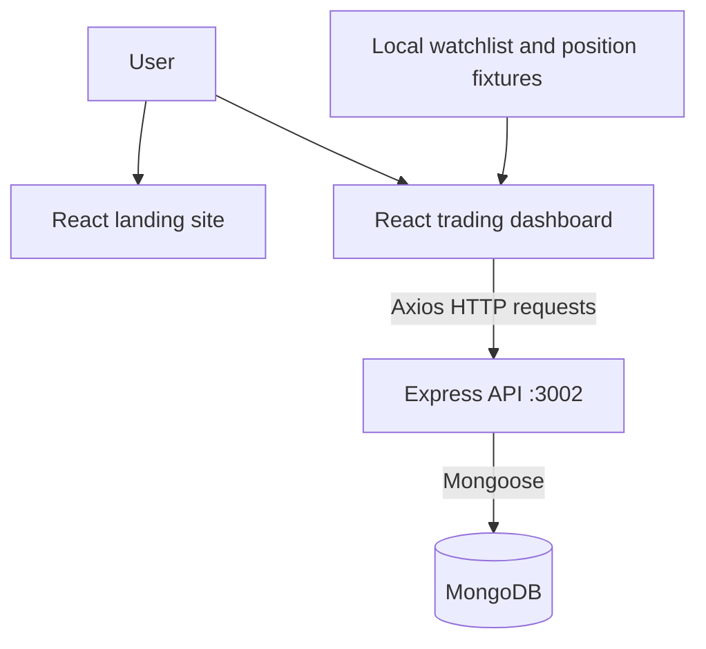

# TradeHub — Full-Stack Trading Platform

TradeHub is an educational stock-trading platform UI with a React landing site, a separate trading dashboard, and an Express API backed by MongoDB. It brings together sample market data, portfolio views, and a basic buy-order submission flow to demonstrate how a multi-part full-stack application fits together.

**Learn. Trade. Track. — A full-stack trading experience built for learning.**

[](https://react.dev/)
[](https://nodejs.org/)
[](https://expressjs.com/)
[](https://www.mongodb.com/)
[](https://developer.mozilla.org/en-US/docs/Web/JavaScript)

## Project Overview

TradeHub is a hands-on full-stack learning project inspired by the layout and workflows of modern trading platforms. It demonstrates how separate React interfaces can present product information and a trading dashboard, while a Node.js/Express API reads and writes portfolio-related documents in MongoDB.

Users can explore the landing pages, view a dashboard with a static watchlist and sample positions, inspect holdings retrieved from the API, and submit a basic buy order. The project was built to practice React component composition, client-side routing and state, HTTP requests, API design, and database integration; it is not a live brokerage service.

## Key Features

- **Separate React experiences:** a public-facing site with home, about, products, pricing, support, and signup pages, plus a dedicated dashboard application.
- **Trading dashboard views:** summary, orders, holdings, positions, funds, apps, and watchlist navigation.
- **Watchlist and charts:** sample instrument data is displayed with a doughnut chart; values are local fixtures, not live market data.
- **Holdings view:** holdings are fetched from the backend and displayed with calculated current value and profit/loss, plus a chart.
- **Buy-order entry:** a watchlist action opens a quantity/price form and sends a `BUY` order to the API for MongoDB storage.
- **Express API and MongoDB models:** Mongoose schemas represent holdings, positions, and orders; the API includes sample-data seed routes.
- **Shared UI state:** React Context controls opening and closing the buy-order dialog.

> **Current scope:** Authentication is not implemented. The sell control is presentational and does not submit a sell order. Orders can be created, but there is no API or dashboard view to list them. The dashboard's positions and watchlist views use local sample data (the backend also includes a route to seed position documents), and submitting an order does not update holdings.

## Screenshots & Demo

Screenshots and a hosted demo are not currently included in the repository. Suggested screenshots to add when available:

```text
screenshots/
├── landing-page.png
├── dashboard.png
├── holdings.png
├── positions.png
└── orders.png
```

<!-- Add images when screenshots are available, for example:  -->

- **Live Demo:** Not deployed
- **GitHub Repository:** [KavyashreeSN/Trade-Hub](https://github.com/KavyashreeSN/Trade-Hub)

## Tech Stack

| Layer | Technology | Use in TradeHub |
| --- | --- | --- |
| Landing site | React 18, React Router | Public-facing pages and client-side navigation in `frontend/` |
| Dashboard | React 18, React Router | Trading views and dashboard navigation in `dashboard/` |
| UI and charts | Material UI, Chart.js, `react-chartjs-2` | Dashboard icons, tooltips, and portfolio/watchlist charts |
| HTTP client | Axios | Dashboard requests to the Express API |
| Backend | Node.js, Express 4 | JSON REST endpoints and server setup |
| Database | MongoDB, Mongoose 8 | Persistence and schemas for holdings, positions, and orders |
| Language | JavaScript | Frontend and backend implementation |
| Development tools | Create React App, npm, nodemon | React development/build scripts and backend restart during development |

## System Architecture

The marketing site and dashboard are separate React applications. The dashboard communicates with the Express API over HTTP; the API uses Mongoose to access MongoDB. Some dashboard content remains local sample data and does not pass through the API.



## Project Structure

```text
TradeHub/
├── backend/
│   ├── index.js              # Express app, API routes, MongoDB connection
│   ├── model/                # Mongoose model definitions
│   ├── schemas/              # Holdings, positions, and orders schemas
│   └── package.json
├── dashboard/
│   ├── public/
│   ├── src/
│   │   ├── components/       # Dashboard pages, charts, and UI components
│   │   └── data/             # Local sample market/portfolio data
│   └── package.json
├── frontend/
│   ├── public/
│   ├── src/
│   │   └── landing_page/     # Home, about, products, pricing, support, signup
│   └── package.json
├── .gitignore
└── README.md
```

## How It Works

### Authentication Flow

There is no authentication flow in the current application. Passport packages appear in the backend dependencies, but Passport is not configured or used by the server routes. API endpoints are currently unauthenticated.

### Buy-Order Flow

1. A user selects **Buy** for an instrument in the dashboard watchlist.
2. React Context stores the selected instrument and displays the buy dialog.
3. The dialog sends the instrument name, quantity, price, and `BUY` mode to `POST /newOrder`.
4. Express creates an order document through the Mongoose `OrdersModel`.

This records an order request only. It does not execute a trade or recalculate holdings.

### Portfolio Data Flow

The holdings page requests `GET /allHoldings`; the backend reads holding documents from MongoDB and returns JSON. The dashboard then renders the rows and calculates current value and profit/loss from the returned quantity, average cost, and price. Positions are currently read from local fixtures, and the orders screen is a static empty state.

## Installation & Setup

### Prerequisites

- Node.js and npm
- A MongoDB instance available locally or through a MongoDB connection string

### 1. Clone the repository

```bash
git clone https://github.com/KavyashreeSN/Trade-Hub.git
cd Trade-Hub
```

### 2. Install dependencies

Run these commands from the repository root:

```bash
cd backend && npm install
cd ../dashboard && npm install
cd ../frontend && npm install
```

### 3. Configure the backend environment

Create `backend/.env` and set the required MongoDB connection string. `PORT` is optional and defaults to `3002`.

```env
MONGO_URL=mongodb://127.0.0.1:27017/tradehub
PORT=3002
```

Ensure MongoDB is running and reachable at the configured URL.

### 4. Start the backend

In a terminal from the `backend/` directory:

```bash
npm start
```

### 5. Start the dashboard and landing site

In two additional terminals:

```bash
cd dashboard
npm start
```

```bash
cd frontend
npm start
```

Create React App uses port `3000` by default and may offer another port when it is already occupied. The dashboard's API requests currently target `http://localhost:3002` directly.

## Environment Variables

| Variable | Required | Purpose |
| --- | --- | --- |
| `MONGO_URL` | Yes | MongoDB connection string read by the backend |
| `PORT` | No | Backend listening port; defaults to `3002` |

Never commit `.env` files or API keys to GitHub. The repository `.gitignore` excludes environment files.

## API Overview

The backend listens on port `3002` by default. These routes are defined in `backend/index.js`:

| Method | Endpoint | Purpose |
| --- | --- | --- |
| `GET` | `/allHoldings` | Return all holdings from MongoDB |
| `GET` | `/allPositions` | Return all positions from MongoDB; the current dashboard uses local fixtures instead |
| `POST` | `/newOrder` | Create an order document using `name`, `qty`, `price`, and `mode` from the JSON body |
| `GET` | `/addHoldings` | Insert the hard-coded sample holdings into MongoDB |
| `GET` | `/addPositions` | Insert the hard-coded sample positions into MongoDB |

The two `/add...` routes mutate the database despite using `GET`, and the routes currently have no authentication. They are sample-data helpers, not production-safe APIs. There is no endpoint to retrieve or execute orders.

## What I Learned

- Structuring a project as separate React applications with their own routes and dependencies.
- Composing dashboard views from reusable components and coordinating UI state with React Context.
- Connecting a React client to an Express API with Axios and JSON requests.
- Defining Mongoose schemas/models and reading or creating MongoDB documents.
- Separating persisted records from local fixture data and tracing data through UI, API, and database layers.
- Managing local configuration with environment variables and excluding `.env` files from version control.
- Using Git and GitHub as part of a full-stack development workflow.

## Challenges & Implementation Notes

- **Keeping the application organized:** the landing site, dashboard, and API are separate packages, each with its own start scripts and dependencies.
- **Connecting UI actions to persistence:** the dashboard's buy dialog uses shared context for its open/close state and Axios to submit data to the order endpoint.
- **Working with mixed data sources:** holdings are loaded from MongoDB, while the watchlist and positions use local fixtures. Making this boundary explicit helps avoid treating sample values as live account data.
- **Protecting local configuration:** the backend reads its connection string from `MONGO_URL`, and the root `.gitignore` excludes `.env` files.

## Future Improvements

- Add authentication and authorization, and protect user-specific portfolio data.
- Implement sell orders, order validation, order history, and a consistent order-to-holdings workflow.
- Move the API base URL into environment-based frontend configuration and add loading/error handling.
- Replace fixture data with a market-data provider and clearly handle stale or unavailable prices.
- Add interactive charts, portfolio analytics, and improved mobile layouts.
- Add automated API/component tests and deployment configuration.

## Learning Acknowledgement

This project was developed as part of my full-stack learning journey using an Apna College project/tutorial as a learning reference. The purpose was to gain hands-on experience with React, Node.js, Express, MongoDB, APIs, and full-stack application architecture.

## Disclaimer

TradeHub is an educational project created for learning purposes. It does not provide real financial trading or investment services and should not be used for actual investment decisions.

## Author

**Kavya Shree S N**<br>
Computer Science & Engineering Student

Areas of interest: Full-Stack Development, Artificial Intelligence, and Software Engineering.

- **GitHub:** Add profile link
- **LinkedIn:** Add profile link
- **Portfolio:** Add portfolio link
